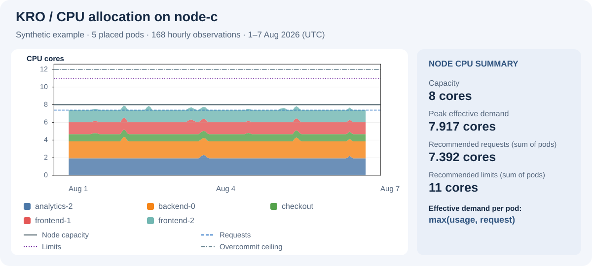

# Kubernetes Resource Optimizer

Kubernetes Resource Optimizer (KRO) provides recommendations for pod sizing and placement
using temporally aligned CPU and memory usage histories. It optimizes resource utilization and infrastructure cost while preserving demand satisfaction. By evaluating pods together, KRO accounts for simultaneous peaks and complementary usage profiles when sharing node capacity. Requests are calculated from configurable historical coverage
requirements. Limits and placement are optimized jointly through mixed-integer
linear programming (MILP), first minimizing active-node cost and then maximizing
spike-weighted normalized limits. An optional fairness objective can be inserted
between the two stages to promote a balanced allocation of headroom above
requests. KRO runs entirely offline on local CSV files and
provides recommendations without connecting to a cluster.

**Stack:** Python · PuLP · HiGHS / CBC · pandas · Matplotlib

<p align="center">
  
</p>

*CPU allocation on node-c from the bundled synthetic example, alongside its
recommended resource settings. Effective demand is max(usage, request) per pod.
The full [example HTML report](output/example/example.html) includes sizing,
placement, and diagnostics (download and open locally).*

## Setup

Requires Python 3.12+ and [uv](https://docs.astral.sh/uv/).

```console
uv sync
```

## Usage

Provide `nodes.csv`, `pods.csv`, and `usage.csv`. CPU is measured in cores,
memory in MiB, and all pods must share aligned timestamps. Both `pods.csv` and
`usage.csv` require the identifier column `pod_id`.
See [example inputs](data/examples).

```console
uv run kro \
  --nodes data/examples/nodes.csv \
  --pods data/examples/pods.csv \
  --usage data/examples/usage.csv \
  --time-limit-seconds 300 \
  --output-dir output/example
```

HiGHS is the default solver; CBC is also available. The command prints
recommendations and diagnostics and writes a single HTML report when `--output-dir`
is supplied. Its name is `<output-directory-name>_<YYYYMMDD>.html`, using the
current local date. All
charts, styles and scripts are embedded.

Run `uv run kro --help` to see all configurable parameters.

Recommendation quality depends on how well the historical data represents future demand.

Use `--limits-mip-gap 0.01` to accept a 1% relative optimality gap in the final
weighted-limit phase. The default is `0`. Optional fairness has its independent
`--fairness-mip-gap`; node cost always requires zero gap. Gap termination is
reported as approximate.

## Documentation

- [Technical documentation (PDF)](docs/KRO.pdf): model explanation, input schemas,
  parameters, fairness, solver behavior, and limitations.
- [MILP formulation](docs/formulation.md): mathematical notation, objectives,
  and constraints.

## Development

```console
uv run pytest
uv run ruff check .
uv run mypy src
```
